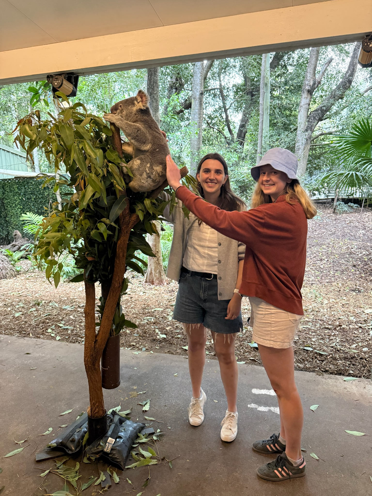
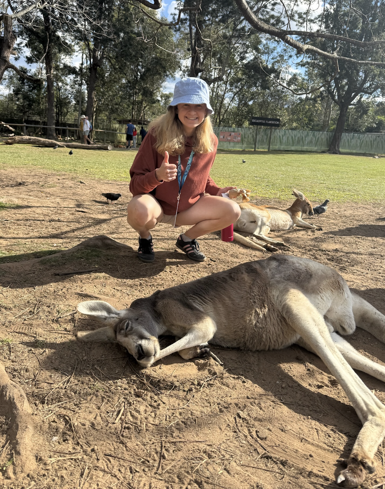
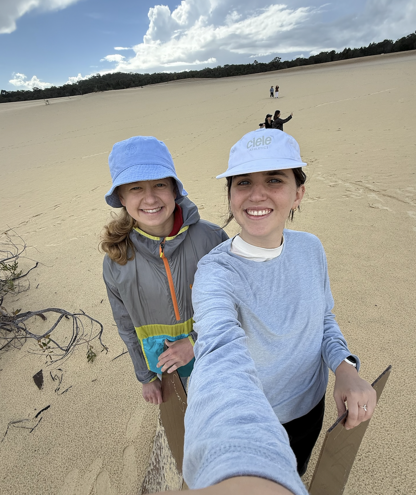

Last year, after USCOTS 2025, [Sara Colando](https://scolando.github.io/) and I started to dream about the possibility of attending [ICOTS 12](https://icots12.oa-event.com) in Brisbane, Australia. We assumed there would be a very slim chance of being able to get the funding to attend, but we had such a valuable experience at USCOTS that we decided to submit an abstract and go for it anyway. Due to the generosity of many individuals, we were able to get enough funding to go, and it was such a fantastic experience that I am beyond grateful for. First, special thanks to [Helen McGilvary](https://www.qut.edu.au/about/our-people/academic-profiles/h.macgillivray) and ICOTS 12 for providing us early career support to present our work and well as for all her hard work organizing the conference. I'd additionally like to thank the Carnegie Mellon Department of Statistics & Data Science *Statbytes* initiative and the CMU Graduate Student Association for financial support. Lastly, extra special thanks to [Alex Reinhart](https://www.refsmmat.com/) for funding, as well as for advising the work that Sara and I presented and always being there to bounce ideas off of.

I had never previously been to Australia, and while I could write a long post about all of amazing experiences that I was lucky enough to have there outside of the conference, I will leave it to a small subset of pictures at the bottom of this and only focus on the academic takeaways :) In this post, I plan to summarize notes and reflections from *a portion* of talks I attended.[^1]

[^1]: I went to *many* wonderful talks over the conference, and some were better to just give my full attention to in person rather than to try to take notes to go through later.

# Talk summaries and reflections

## Beyond the prompt - Mine Çetinkaya-Rundel

Recently I have been hearing a lot of talk along the lines of "if AI can code it for us, do we need to teach students how to program?". My feeling is undoubtedly yes, but I have struggled to formulate my thoughts in a coherent manner on why that is. [Mine's talk](https://github.com/mine-cetinkaya-rundel/beyond-prompt-icots-2026) was fantastic and did a great job of explaining this in a way I previously could not.

Mine began with an example of joining two data frames (a roster of soccer players and number of goals scored in each game) that have a many-to-many relationship. Using AI, the following code is provided, no error is given, and 105 rows are produced. As a result, we'd assume as a human using AI, we'd accept this code and move on.

```{r, eval=F}
roster |>
  left_join(scores, join_by(id), relationship = "many-to-many")
```

However, if we were approaching this problem without the presence of AI, we'd likely use a `left_join()` instead of a `full_join()`, get an error, and use our domain knowledge to manipulate the data in a way that answers the question of interest (e.g. taking the maximum number of goals each player scored across all games). Thus, in this case, it takes critical thinking to recognize the LLM's errorless output is incorrect.

More recently, AI might give options by alerting the user that an individual in the output has multiple rows and asking how they want to proceed. But only newer versions (particularly paid versions) show this consistently. So, we turn to three ideas: **instilling curiosity**, **teaching to mastery**, and **cultivating skepticism**.

By *instilling curiosity* in students, we are encouraging them to think critically about the question of interest and all those little decisions that go along with it (e.g. do we want one number for each soccer player or multiple). *Teaching to mastery* emphasizes the idea that a good data scientist needs to evaluate generated code to make sure it does what it says. One analogy that Mine brought up that really resonated with me is the idea of reading comprehension. Growing up, reading comprehension is always done alongside writing, because it is difficult to do it well if we haven't done ourselves. The same idea applies to coding: it is difficult to evaluate code if we haven't ever learned to code ourselves.

Lastly, we have to *cultivate skepticism*. Mine showed an example related to modeling data from a Poisson distribution. An LLM fit a model and concluded that there was overdispersion, and thus some quasi model might be a better fit. However, through EDA, it was clear that the issue was not actually overdispersion, but rather that an interaction was needed. No LLM that did not require a credit card was able to pick this up. So, if students are using an LLM for their analysis, they need to be skeptical enough and need to know enough to ask for an EDA plot.

I think all three ideas point back to a quote that Mine mentioned at the end of the presentation: "There is no substitute for simply looking at data properly". Plus, personally, I think data science is way more fun if you can really think creatively about the data and uncover challenges and address the challenges your analysis rather than letting an LLM spit out maybe the most homogeneous (but not best fitting) approach right back at you.

### Approaches

There are three approaches that Mine covered for moving forward. **Approach 1** is to *level the playing field with explicit "how to best AI" instruction*. Something that I liked that Mine mentioned was that she has been learning Python and this has helped her understand her students' position. Not being proficient in Python myself, I could see how if I were to try to learn, I might better understand what students are getting stuck on and when they might turn to help when learning a new coding language. So just making a mental note here that when I start learning more Python for thesis work to take notes on difficulties/frustrations. Looping back to the approach, Mine mentioned a few things here:

- Rather than trying to level the playing field all one lecture, it might be best to meet students where they are at and periodically mention a trick you have picked up or trap you have fallen into throughout the course of the semester.

- Give explicit examples for proper, sufficient citation of LLMs. Don't expect students to get it right on their own.

- Provide `AGENTS.md` files and/or system prompts for properly calibrated interactions with AI tools if using Positron integrated with AI. This was pretty cool/new to me, it tells the agent how to act (e.g. as a TA) and what it should not do. You can also add an academic integrity note and the agent will respect it. The main con is you will have to expect to update this file every semester, if not more often.

- Also teach the what, the how, and the ethical considerations to help determine for themselves whether/how to use these tools.

  - I think this was an important point, and I could think more about how to convey to students the power and consequences of the tools they are using. I am curious how many students really understand what is happening when they offload a task to AI (meaning understand the backend of how AI works, the ethical and environmental dimensions, as well the potential effect on student learning).

**Approach 2** is to *emphasize workflow best practices, especially version control*. This was something I'd never thought of before in connection to AI and a really cool thought. The idea is that have a visual dif will allow students to help see what was changed by the LLM and contemplate whether we actually want to make those changes. This makes sense, as oftentimes when feeding an LLM code or writing, it spits something back out and you have no idea what change was actually made. As a result, I think there is a temptation to just copy that new "better" version and mindlessly incorporate it into your workflow.

**Approach 3** is to *shift AI use from taking shortcuts toward supporting learning (+ experiment with building with AI)*. This links back what I remember Mine talked about at USCOTS: the idea of using AI to help give feedback. Because an increasing number of students use AI tools as a first step when they don't understand something, can we somehow insert ourselves at that point and redirect their tendencies? Additionally, because with large class sizes we already have very detailed rubrics, and the fact that TAs would rather encourage with students than grade AI-generated work, can we create some real time feedback system? The system basically works by a student working real time in RStudio, they say they want feedback, what they wrote it sent to an AI backend with `ellmer`, and then the student gets feedback based on the rubric that looks like human feedback. A few notes:

- Automated checking is not a new idea, but checking a narrative is.

- The university/IT is funding this currently, so it is free of charge to the students.

- They still randomly select one question and grade it.

### Hard questions

There were a few questions/points that either Mine mentioned throughout this talk as tricky questions or that were asked that I thought were worth jotting down and thinking more about moving forward (or maybe *trying* to think more about going forward, as these don't have straightforward solutions).

- In response to seeing different quality of output from different LLMs, and particularly getting better output at a price, what is the role of open source tools and how to ensure equity of student learning in the classroom?

- Related to the value of having students learn to code themselves (teaching to mastery point), what level of assistance does AI play here?

- We cannot assume all students are using these tools, in fact, we know some students are very against LLMs and should not have to use them to succeed. So how does this affect our grading rubric?

- What stops a student from putting the assignment into ChatGPT not the system? Mine answered this with some good points:

  - AI reduces the amount of time needed to answer a question, which is problematic because time on a task is important (gets you to struggle, think critically and process things, etc). With LLMs, students are producing better quality output and learning less. Homework needs to be a time practice for the actual assessment (in class), so it is a lower percentage of the grade but it can heavily inform the assessment so that students that take the time are rewarded. In the most extreme case, maybe you make a slightly personalized exam for each person where, for instance, you pull some piece of code they wrote on their homework and ask them to explain what it does on the exam.

  - For self care and kindness to students not there to just scoot by, it is best to build thing for the good/average players.

## Real-world contexts and Interdisciplinary Approaches

### Intro stats through sustainability applications

I enjoyed this talk by Nicholas Bussberg from Elon University on ways to address global issues such as sustainability and climate change while teaching statistics. My notes from the session/paper:

- Given that we teach students to interpret confidence intervals, natural next questions are things like *what should we do or recommend with this result?* *How does this make the student, with their own life experiences, feel?*

  - If we can provide and environment to discuss questions like these, we can not only better support students' learning, but also address further dimensions of the work.

- Most (but not all) examples, activities, homework, and projects in Nicholas' course were centered around sustainability.

  - Roughly a 30 person class composed of mainly first and second-year students and is required for statistics and biology students. Topics include study design, descriptive statistics, visualizations, hypothesis testing (t, ANOVA, Chisquared, one-sample proportion tests), confidence intervals, and simple linear regression.

- Used the United Nations (UN) Sustainable Development Goals framework, which have goals that go beyond sustainability in the traditional sense (recycling).

  - Datasets from Tidy Tuesday, JEDI-CAUSE site, Skew The Script (household income and race/ethnicity data from U.S. cities, Flint water crisis), The Statistical Sleuth (cloud-seeding).

- To encourage conversation, opened each class with a short, no-stakes google form that asked student how they are, fun ice-breaker, and statistical or sustainability-related question.

  - For class sessions that focused on sustainability examples, students also had short pre-class readings and questions were related to that. Then had small group and full group discussions that built on this (10-15 minutes total).

  - Example: pre-class, students watch a video about cloud seeding. Survey questions ask them (with a likert scale) how they feel about people using cloud seeding to increase rainfall and what takeaways they have from the video. Discussion questions include *What open questions do you have about cloud seeding? Why might someone prefer or oppose cloud seeding?*.

    - Structured full class discussions in a way to reduce a student feeling pressured or isolated based on their viewpoint (e.g. why might someone think this way).

- Sustainability focused capstone projects divided into a group coding product and an individual assessment on the group product.

  - Groups had autonomy in choosing the SDG to investigate and the respective research question. Project 1 was EDA focused (audience: friend with no statistics background) while in Project 2 students performed inferential statistics that included a p-value and confidence interval (audience: organization focused on furthering an SDG).

### Developing and teaching community-engaged statistics & data science courses

I think I got my first experience with a class related to community-engaged statistics at Macalester when I took Projects in Data Science with Brianna Heggeseth my senior year, which was great. It wasn't necessarily focused on community-engaged applications specifically, but I think we had to come up and an idea and find an external advisor ourselves. I remember that my friend and I worked with someone from the MN Pollution Control Agency on a project related to PFAS in superfund sites, and that learning how to collaborate with an external partner and tailor our analysis and final product (a shiny app) toward their interests was an interesting and valuable experience. I specifically remember they did not end up wanting to make our results public due to liability reasons...there maybe could have been some better communication along the way from both us and them to prevent that from happening in the end. So, I went to this talk and looked at the corresponding conference paper by Claire Kelling, Tyler George, Laurie Baker, and Emily Robinson to better understand how they are incorporating community-engaged statistics and data science (CESDS) into their courses.

Helpful tips on collaborating with the community partner and expectations:

- Sit down with community partner beforehand (Tyler did this 9 months before!) to discuss expectations and sign (informally) some agreement.

  - Consider length of course and use that to decide how fast community partner should respond to emails. Tyler's course was only around 18 days, so he needed a one day turnaround.

  - Keep at least two lines of communication with the community partner in case on person stops responding.

- Ask community partner for their core problem, goals and measure of success, whether they have data that can be delivered in time for the course and how much cleaning it will require, and who the relevant stakeholders are.

- Need to consider if the final product the community partner has in mind aligns with learning objectives from the course.

- Additionally, consider how the work will be used after the course ends, who will maintain the products if necessary, and what documentation or training is needed to make sure the work remains useful.

After the talk, I was interested in learning more about how they designed learning objectives, given that it seems like depending on the community partner's interests, there can be quite a bit of variability where you end up on the scale of statistical rigor. Slightly paraphrased in some cases, the goals were:

- *Goal 1*: Critically examine the implications of working with data from a community (identify ethical concerns, representation issues, biases, etc.), analyze potential impacts of these concerns on community members, and suggest appropriate courses of action to address them.

- *Goal 2*: Apply statistics/data science skills to co-create sustainable solutions to community-identified challenges with community members, with integration of local knowledge and community context.

  - Assessment: technical accuracy and strength, but also the final product should acknowledge the information and context derived from discussions with partners and include a plan for project sustainability.

- *Goal 3*: Communicate effectively with community partners/stakeholders about methods, statistical results, and practical insights through active listening, culturally responsive questioning, and soliciting and integrating feedback throughout the analysis process.

  - Assessment: throughout the research process (from preparatory questions before the first meeting to the final presentation).

- *Goal 4*: Develop collaborative competencies within statistical teams by assessing personal growth areas, practicing effective communication and perspective-taking across differences, and utilizing effective project management skills and tools.

  - Assessment: Individually (reflect on own strengths and areas for development with a personal development plan) and in teams (team contracts/project plans). Collaborative and effective use of GitHub could be assessed through commit tracking, issue creation, and repository organization.

Overall, this session was very helpful in hearing the presenters' past experiences designing a course like this. The learning objectives I think were particularly helpful. If I am to implement a course like this in future, I would still grapple with what prerequisites to have for it, and I think part of that depends on the needs of the community partners, which is likely another reason why planning so far ahead is important.

## Creative ideas

There were a few sessions that I went to that I found to have very fun, creative ideas for activities that I would not have thought of myself but would like to try out one day.

### Categorical data from images

This talk by Anna Fergusson was about helping students better understand categorical data and proportional reasoning through image-based labeling. My understanding of the motivation is was that while categorical data are often taught as objective (e.g. eye color, yes/no values), in reality they can include “labels” assigned by humans based on perception or personal judgement. As a result, understanding the social context in which the data were constructed or involving learners in the construction of categorical data can support interpretation. Specifically, images also provide an engaging data-context and can be drawn from contexts which allow the identification and exploration of societal biases.

Anna talked about implementing a "movie posters" application for large class sizes (350+ students). This task had four sections:

- *Connect*: students watch a YouTube video that featured people of color recreating iconic movie posters and proportional statements, then summarize five things they learned from watching the video.

- *Apply*: students choose a word and use IMDb website to search for movies with this word in the title. Students then use the “Sorting movie posters” data landscape web app, enter their search word and get 20 movie posters with it.

  - Students describe two different categorical variables that they could measure about the movie posters (e.g. position of title, background color).\
  - Students name the categorical variable and define its levels, then move the posters around on the screen to cross-classify the posters by the two different categorical variables. Then they create a two-way table of counts.\
  - Students then calculate and use two different kinds of proportions in sentences to describe their movie posters (overall, conditional, joint proportions).\

- *Create*: students were given R code that supported them to access and visualize data about movies from an API, using the same search word they selected in the apply section.

- *Reflect*: student describe in their own words one important idea from the topic. They were also answer questions:

  - What things about the world, data, or models did the online lab make you curious about exploring further or learning more about?\
  - In terms of your understanding, which one of the three learning objectives for this topic do you feel the most confident about?\

The results showed the task promoted student curiosity, creativity, and diversity in how students “see data”, and led to valid interpretations of proportions.

### Orange Peeling Increases Motivation for Statistics

This talk was given by Kathrine Frey Frøslie and I found it very engaging. Kathrine teaches a large class at Norwegian University for Life Sciences, which is largely composed on non-statistics majors (e.g. vets). As a result, the students' motivation for learning statistics is not the highest. To change this, Katherine implemented a roughly hour long activity on peeling oranges. First, she gave the history behind how oranges were used to treat scurvy hundreds of years ago. Then, each student got an orange, a timer was set, and all students tried to peel their orange as fast as they could and recorded their time. Once the oranges were peeled, the students also counted the number of slices in their orange (discrete variable). Students can then analyze this orange data collected by the class with numerical summaries and data visualization. In more advanced classes, the analysis could be extended to include repeated measures (multiple oranges peeled per student). Results showed that students' motivation for statistics shifted more positively following the orange intervention. Some students even associated statistics with the smell of oranges :)

### Collaborative Keys

Laura Le gave a talk about implementing collaborative keys for an online graduate student course she teaches at the University of Minnesota. The idea behind collaborative keys is that students fill in the answer key for an assignment themselves and somewhat engage in a conversation on the google doc to answer each question. Once an answer looks good, the instructor "closes" that question with a positive comment. In order to receive credit, students have to engage up to some level (graded on completion, not accuracy), which can technically be up to the extent of saying, "I agree with XYZ", although students are encouraged to put forth answers themselves.

There were a few challenges with the collaborative keys

- There was a wide variety in participation: some students answered too many questions, even when encouraged not to, while others took the "I agree" approach.\
  - Alternatively, each student or group of students could be assigned a question to answer and another question to give feedback on.
- Some students may have felt uncomfortable answering questions they were not confident in. Maybe anonymization would help this?\
- Overly verbose answers: this does not pervade AI.\
- Timing: what happens if the answer is incorrect for a while before the instructor gets to it, and this is the last thing students see? I assume there could just be some policy where the final key is posted one day after the deadline, but if students are completing this *after* the homework is due this can result in delays.\
  - I don't actually remember if this was done concurrently or after the initial assignment was due.

But also several benefits, including, but not limited to...

- Students get to interact with classmates in an online environment\
- Students get to see how other students explain concepts (sometimes this could actually be worded in a way that makes more sense than an instructor explanation)\
- Less work for the instructor/TAs as they don't have write solutions, and, depending how the class is structured, grade the homework

### Pre-release exam datasets 

This talk by Dennis Sun and Madeline Schroth covered pre-release exam datasets, which are intended to preserve the benefits of take-home assessments (authentic data work) while the in-class exam holds students individually accountable. As a result, it rewards students for practicing data analysis outside of class time, even though the assessment takes place in class. The framework has three phrases: 

1. The instructor provides a dataset to the students, one week prior to the exam. \
2. Students analyze the data at home using technology (e.g. R). They are encouraged to visualize the data and fit models and may create a one double-sided page "data report" that contains printed plots, summary statistics tables, model outputs, and handwritten annotations interpreting the findings. \
  - Collaboration and AI assistance during this phase are permitted and even
encouraged (prepares students for a world in which AI will increasingly be used to do statistics). 
3. The exam takes place in a proctored environment, with questions based on the pre-released dataset. Students are allowed to bring their the data report and use it during the exam.

This framework can either take a guided or unguided path. The guided phase gives students guided questions to look into prior to the exam, and the exam in Phase 3 is based on those questions. This is different than the unguided path, where the instructor provides dataset and codebook, but no guidance otherwise. 

  - While both approaches should prevent students from completely offloading to AI,  open-ended approach is more robust, as there are too many avenues of inquiry to explore. This means students still have to exercise judgment about what aspects are interesting and important. They also get practice asking good questions, which is an important part of research. \
  - But have to be careful about what types of questions you do with open-ended approach, since you cannot assume a student has done a particular analysis. \
  
This approach also may help reduce student anxiety, as students enter the exam with lower cognitive load regarding the domain (although, if I remember right, during the talk they might have said that student anxiety was unchanged with PRED). Overall, I found this idea pretty interesting and think it could work well in particular contexts in courses like 36-401, 36-402, 36-617, or 36-707 at CMU. I think the main concern that I have is figuring out how to provide the right level of output on the exam that rewards students for doing thorough exploration while still giving students who didn't explore that particular aspect of the data a fair shot.

## Data Science Ethics

I have been wanting to learn more about how different schools incorporate data science ethics into their curriculum given how relevant and important this topic is with evolving technology. In particular, I've been curious to learn whether ethics is incorporated in discussions here and there across many courses, as it was at Macalester, or if there are programs with a stand alone course focused on ethics of data science[^2]. The course, [DS190](https://ds190-capstone.netlify.app/), that Jo Hardin described, is a capstone course with 5 class periods focused on data science ethics throughout the semester. 

[^2]: Note to self, do CMU classes have any kind of ethics discussions/training at the undergrad level?

The prerequisites for this course included all DS minor core courses (statistics, linear algebra, computer science, data science, and ethics in data science[^3]), and last year the course had 11 students, though this fall it will have around 30. The course was designed around statistics applications to...

[^3]: Interesting that *ethics in data science* is prerequisite. I'd be curious to learn about the structure of this course. 

- Economics: what is collusion and why can it be bad for consumers? Specifically focused on algorithmic collusion \
- Psychology: understanding sources of bias in human data (measurement, validity, representativeness) \
- History: how history of eugenics interfaces with the history of statistics, how facial technology can lead to rascist policies \
- Linguistics: why LLMs are not language, what role do researchers, policy makers, and social media users play in LLM use/abuse?
- Philosophy: algorithmic methods cannot (and should not) be value-free. Discussion on which ethical concerns are most important to incorporate into a given algoirthm.

I thought it was great how well the course plays to the strengths of liberal arts colleges by using interdisciplinary collaborations. I would love to make good connections with faculty in other departments if I get to work at a liberal arts college, both to be able to have discussions surrounding ethics like this, as well as for collaboration on research.

To evaluate students' growth with the ethics component, they were asked the same questions on the first and last day of class. It was found that students showed growth in the role that a data scientist plays and were able to think carefully about the ethics surrounding their own data science projects. I will definitely return to Jo's website to check out some of the materials her class was discussing surrounding ethics.

## Inclusive teaching practices

### Informed Pair Programming

With a flipped classroom and small/medium class size, many in-class activities are done in groups or pairs. This kind of collaboration can be super valuable by improving learning outcomes, belonging, and retention, as well as developing students' collaboration/communication skills. However, with collaborative learning there can also be issues of unequal power distribution between peers, which is what this talk by Judith Canner and Allison Theobold addressed.

Complex Instruction (CI) explicitly seeks to disrupt status hierarchies in group work that lead to unequal participation. It is grounded in three guiding principles (Cohen & Lotan, 1997):

- using “group-worthy” tasks that require multiple abilities to complete

- establishing norms and roles that promote autonomy and interdependence

- attending to individual status through ongoing instructor support and mechanisms of group accountability.

Through CI, the goal is to create *equitable* collaboration, which is different than *equality*. Equitable collaboration means interactions in which students have equal opportunities to contribute meaningfully to the shared work. Equality assumes identical outcomes for all students. An equitable approach acknowledges that there are certain circumstances that students may need different forms of support to achieve comparable opportunities to participate.

The informed pair programming was implemented in introductory data science classes in both CSUMB and Cal Poly and used two roles: **Coder** and **Developer**.

- Coder: leads problem-solving process by determining the solution strategy, providing instructions for what the Developer should type, and managing supporting resources (e.g.,textbook, R cheatsheets)

- Developer: executed the Coder’s instructions, ran the code, and evaluated whether the output met the requirements of the prompt.

The idea is that by separating decision-making from typing, the typist cannot dominate the activity as you might see in a traditional structure. In the presentation, the authors compared *intellectual merit* (reflects the degree to which a student’s ideas are treated as high- or low-quality) across different gender pairings and examined whether prior programming experience (*technological authority*) influenced group discourse. They found evidence of both disciplinary/technological expertise and gender status systems.

- The difference in status showed by behaviors such as taking over the keyboard, speaking outside one’s assigned role, or dismissing a partner’s ideas.

- At Cal Poly, in woman-woman pairs, Statistics majors had higher intellectual merit when only one member of the pair was a Statistics major. However, if it was a man-woman pair, women who were Statistics majors were not afforded the same intellectual merit (men often positioned their own ideas as more legitimate).

- AT CSUMB, there was evidence that technical expertise could elevate a student’s status. Women with technological authority reported more negative experiences with pair programming compared to peers.

Altogether, the findings indicated that the protocol needed to be revised to more effectively support equitable collaboration. So the changes that were made were changing *Developer* to be renamed as *Computer* in order to more accurately describe the student’s function. Additionally, the Coder is now explicitly tasked with articulating their thinking, including points of confusion, while the Computer is responsible for encouraging this verbalization and ensuring that the Coder maintains control of the solution strategy. To promote role adherence, the instructors also created a role-specific protocol sheet which students physically exchange during role switches, and only allow partner currently occupying the Computer role to operate the keyboard.

Overall, I liked these ideas and would be curious to see how it goes trying it out in my own class at some point. My main concern is when you have big differences in knowledge of the material, which I think is very possible especially with AI present. I think Allison and Judith mentioned that AI use during class was viewed as disrespectful to your partner and not allowed (which seems like a smart choice to me), but I could see if Student A is offloading everything to AI and has a weaker coding background and is in the Coder role, and Student B is advanced in tidyverse and has to type things they know will give errors, Student B might get quite upset. Or at least I think I would struggle in this situation. I would be curious to learn more about if/how Allison and Judith dealt with this.

### Supporting English Language Learners in Statistics & Data Science

This talk by Lisa Bolton discussed integrating support for English Language Learners (ELLs) at various scales, based on past work done in Canada, Aotearoa New Zealand, and China. Lisa defined an ELL to be a student who speaks another language (or languages)
more fluently than they speak English and need support to engage confidently in the standard English dialect of their educational environment. 

Teaching practices to support ELLs included:

- Pausing: maintain a natural speaking pace but insert strategic pauses (don't slow down or shout). \
  - This allows ELLs to hear the question in English, translate it back to their native language, think of the answer in their first language, and translate that back to English. \
- Speaking and writing instructions and answers \
  - Having written instructions in addition to speaking in class helps ensure that students have a shared reference for what they are supposed to work on and helps students who may miss steps in multi-step instructions if they need more time to process. \
- If TAs speak the same first language of the student, use the first language to provide encouragement, but switch to English for discussions of content.
- Be wary of using data that students' may not be familiar with (e.g., Canadian ice hockey). \
  - This was a good reminder, I know one of my friends was TAing last year and was having students ask her what "snoring" was on a question on the final, and some students were not familiar. 
  
  
Generally: The more that ELL students feel safe and that there is a culture where they feel secure enough to take the linguistic risks necessary for learning without fear of judgment, the better. This sense of belonging directly influences motivation; when students feel valued and seen as individuals, they are more likely to engage deeply and persist through academic challenges (Aspelin, 2020).

### Student-Identified Supportive Practices

This talk, given by Laura Callis, Tami Dashley Shah, and Jennifer McNally from Curry College, covered inclusive instructional practices students felt supported
them in learning statistics. These included:

- Using relevant contexts of data during class. \
  - Using data on interesting scenarios (could potentially be useful in students' daily lives, data students' collected, etc.) can help students maintain focus and helps optimize relevance, value, and authenticity. \
  - Examples: collecting data on the campus commuter-student parking permits, analyzing  whether different kinds of music can lead to delinquent behavior, or whether different racial groups were targeted in policing. \
- Having an approachable professor is important. \
  -  When instructors began class by asking about students' day or demonstrated interest in students’ lives, students felt more comfortable asking the professor for help and participating during class time.\
  - This could look like students completing exit cards where they can write if they needed help with anything and then professor responds by email. Or, the faculty could circulated the room and check in with each student.  \
- I was surprised that students' found cold-calling to be an effective practice. Students said this helped them to pay attention and showed that the instructors cared about their understanding. \
  - This likely worked well because the professor allowed the students to pass, without judgement, or would call on an entire group so that no one individual was singled out. \
- Throughout the semester, keep a glossary packet to be filled in during class time or posters of terms and symbols on the walls that were regularly referred to (e.g. this is what p-hat is). \ 
  - Helps students know what to review if they missed a class. \
  - Can go a step further and have examples and non-examples. \
  - Explain things in slight different ways but with consistent language. \

# Reflections for the future

Now that Sara and I are largely wrapped up with our project about AI's impact on student's writing style, we are in the brainstorming phase for another side project (maybe). I want almost all of my focus this next year to be on my dissertation and working toward the thesis proposal, so not sure where that puts an education side project, as at some point (in the future) I also want to do side project related to baseball. However, through this student writing project, we got lots of great feedback at USCOTS, ECOTS, and ICOTS (so many COTS!) and have really valued getting the opportunity to connect with many smart people thinking about education. If you have taken time to chat with me during a conference *(and have somehow gotten to the bottom of this post)*, thank you! I really appreciate it.

# Pictures

::: {layout-nrow="2"}
{width=30%} {width=29%}
{width=40%} {width=32%}
{width=32%} {width=32%}
:::
